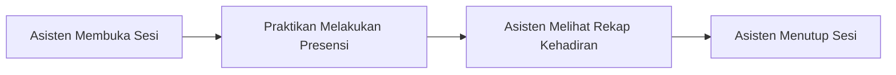
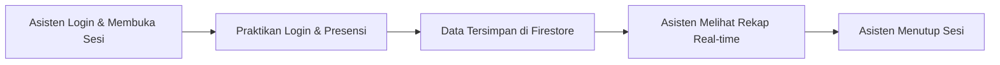
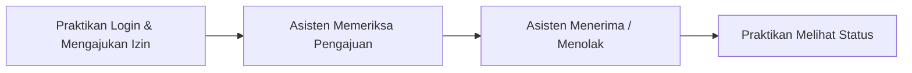

# PRAKTI

> **Platform Khusus Kegiatan Praktikum**  
> Solusi mobile cerdas dan responsif untuk mengelola presensi serta sesi praktikum secara efisien dari dua sudut pandang: **Asisten Laboratorium** dan **Praktikan**.

---

## 📌 Ringkasan Proyek

**PRAKTI** adalah aplikasi mobile berbasis React Native (Expo) yang dirancang untuk memfasilitasi pencatatan dan pemantauan kehadiran kegiatan praktikum. Aplikasi ini mengakomodasi dua jenis pengguna dengan kebutuhan berbeda:

- **Asisten:** Melihat jadwal praktikum, membuka sesi saat praktikum dimulai, memantau kehadiran praktikan secara *real-time*, menutup sesi setelah kegiatan selesai, serta memeriksa pengajuan izin praktikan.
- **Praktikan:** Melihat jadwal dan detail sesi praktikum, melakukan presensi digital saat sesi dibuka, memantau riwayat kehadirannya secara mandiri, serta mengajukan izin jika berhalangan hadir.

### Cakupan Sprint 1
Pada **Sprint 1**, seluruh data (identitas pengguna, jadwal, sesi, dan presensi) dikelola menggunakan data *dummy* lokal dan state aplikasi (*React State / Context*). Fokus utama sprint ini adalah:
- Antarmuka pengguna (UI) yang rapi, adaptif, dan responsif dengan tata letak **Flexbox**.
- Alur kerja (*user flow*) yang tepat, konsisten, dan interaktif sesuai spesifikasi kebutuhan (SRS).

> [!NOTE]  
> Karena belum terintegrasi dengan basis data (*database*), sinkronisasi data presensi antara peran asisten dan praktikan tidak wajib selaras secara terpusat. Penilaian difokuskan pada keakuratan alur kerja dan responsivitas antarmuka.

### Cakupan Sprint 2
Pada **Sprint 2**, data *dummy* diganti dengan data dinamis yang dapat diakses banyak pengguna. Fokus utama sprint ini adalah:
- **Firebase Authentication** untuk registrasi, login, dan logout dengan peran *Asisten* atau *Praktikan*.
- **Cloud Firestore** untuk penyimpanan data permanen dan sinkronisasi *real-time* antar pengguna.
- **Pengajuan izin** oleh praktikan yang diperiksa dan diputuskan oleh asisten.
- **Firebase Security Rules** agar data hanya dapat diakses dan diubah sesuai peran pengguna.

> [!NOTE]  
> Integrasi model AI (klasifikasi alasan izin) belum dikerjakan pada sprint ini. Keputusan izin sepenuhnya ditentukan oleh asisten.

---

## 🎯 User Story

### Sprint 1
- **Sebagai Asisten**, saya ingin melihat jadwal praktikum, membuka dan menutup sesi, serta melihat siapa saja yang sudah hadir, sehingga saya dapat mengelola kehadiran praktikum dengan mudah.
- **Sebagai Praktikan**, saya ingin melihat jadwal dan detail sesi, melakukan presensi saat sesi dibuka, dan melihat catatan kehadiran saya, sehingga saya tahu kehadiran saya sudah tercatat.

### Sprint 2
- **Sebagai Pengguna**, saya ingin mendaftar dan login dengan akun saya sendiri, sehingga tampilan dan tindakan yang tersedia sesuai dengan peran saya.
- **Sebagai Asisten**, saya ingin mengelola data praktikum dan memeriksa pengajuan izin, sehingga data yang dilihat praktikan selalu mutakhir dan keputusan izin ada di tangan saya.
- **Sebagai Praktikan**, saya ingin mengajukan izin dan memantau statusnya, sehingga ketidakhadiran saya tercatat dan saya tahu hasil keputusannya.

---

## 🔄 Alur Demo Aplikasi

### Sprint 1
Alur utama skenario demonstrasi aplikasi:



1. **Buka Sesi:** Asisten memilih jadwal dan membuka sesi praktikum melalui modal konfirmasi.
2. **Presensi:** Praktikan memilih jadwal yang sedang dibuka, mengonfirmasi presensi, dan sistem mencatat waktu kehadiran.
3. **Pantau Rekap:** Asisten membuka halaman rekap untuk memverifikasi daftar praktikan yang telah hadir.
4. **Tutup Sesi:** Asisten menutup sesi praktikum; sesi yang telah ditutup tidak dapat dibuka kembali dan praktikan tidak dapat melakukan presensi lagi.

### Sprint 2
**Alur 1: Presensi terintegrasi**



**Alur 2: Pengajuan izin**



---

## 📋 Daftar Software Requirement Specification (SRS)

### Sprint 1

| Kode SRS | Deskripsi Fitur | Kriteria Penerimaan (*Acceptance Criteria*) |
| :--- | :--- | :--- |
| **SRS-001** | **Pemilihan Peran & Identitas** | • Halaman awal menampilkan formulir pilihan peran (*Asisten* atau *Praktikan*).<br>• Setelah memilih peran, pengguna memilih identitas dari daftar data dummy (Nama & NIM / Kode Asisten).<br>• Tombol lanjut dalam kondisi dinonaktifkan (*disabled*) sebelum peran dan identitas dipilih.<br>• Setelah konfirmasi, pengguna diarahkan ke halaman utama sesuai perannya.<br>• Tersedia opsi untuk keluar (*logout*) dan kembali ke halaman pemilihan peran. |
| **SRS-002** | **Navigasi & Tata Letak** | • Menggunakan React Navigation untuk perpindahan antar halaman.<br>• Asisten dan praktikan memiliki alur navigasi masing-masing (misal: Tab Jadwal & Rekap/Riwayat).<br>• Seluruh tata letak disusun menggunakan **Flexbox** dan responsif di berbagai ukuran layar.<br>• Data dummy (pengguna, jadwal, sesi) dan state bersama (*Context*) disiapkan terpusat. |
| **SRS-003** | **Jadwal & Detail Sesi** | • Menampilkan daftar seluruh jadwal praktikum.<br>• Setiap item menampilkan nama praktikum, kelas, waktu pelaksanaan, dan status sesi (*Belum Dibuka*, *Dibuka*, *Ditutup*).<br>• Status sesi ditandai dengan badge indikator visual yang jelas.<br>• Menekan item jadwal akan membuka halaman detail sesi dengan informasi komprehensif.<br>• Menampilkan *empty state* informatif jika daftar jadwal kosong. |
| **SRS-004** | **Pengelolaan Sesi (Asisten)** | • Asisten dapat membuka sesi yang berstatus *Belum Dibuka*.<br>• Asisten dapat menutup sesi yang berstatus *Dibuka*.<br>• Setiap aksi buka/tutup memicu Modal atau Bottom Sheet konfirmasi.<br>• Perubahan status langsung ter-update di daftar jadwal dan halaman detail sesi.<br>• Sesi yang sudah ditutup tidak dapat dibuka kembali (*immutable*). |
| **SRS-005** | **Pencatatan Presensi (Praktikan)** | • Praktikan hanya dapat melakukan presensi ketika status sesi adalah *Dibuka*.<br>• Jika sesi belum dibuka atau sudah ditutup, tombol presensi nonaktif disertai keterangan status.<br>• Menampilkan Modal atau Bottom Sheet konfirmasi sebelum presensi tercatat.<br>• Mencatat timestamp waktu kehadiran secara akurat saat presensi disubmit.<br>• Memberikan umpan balik visual (*feedback/toast/modal*) bahwa presensi berhasil.<br>• Mencegah presensi ganda: tampilan berubah menjadi *"Presensi sudah tercatat"* beserta catatan waktunya. |
| **SRS-006** | **Rekap Kehadiran** | • **Asisten:** Melihat daftar praktikan yang sudah hadir pada suatu sesi beserta waktu kehadirannya.<br>• **Praktikan:** Melihat riwayat kehadiran pribadi (nama praktikum, tanggal, dan waktu hadir).<br>• Menekan item rekap/riwayat dapat memunculkan informasi pendukung melalui Modal / Bottom Sheet.<br>• Menampilkan tampilan khusus (*empty state*) ketika belum ada praktikan yang hadir atau riwayat masih kosong. |

### Sprint 2

| Kode SRS | Deskripsi Fitur | Kriteria Penerimaan (*Acceptance Criteria*) |
| :--- | :--- | :--- |
| **SRS-007** | **Autentikasi & Keamanan** | • Registrasi, login, dan logout memakai *Firebase Authentication* dengan peran *Praktikan* atau *Asisten*.<br>• Pengguna yang belum login diarahkan ke halaman login.<br>• Error autentikasi (email tidak valid, password salah) ditampilkan dengan pesan yang jelas.<br>• *Firebase Security Rules* membatasi akses data sesuai identitas dan peran pengguna. |
| **SRS-008** | **Data Praktikum di Firestore** | • Asisten dapat menambah, melihat, mengubah, dan menghapus data kelas, peserta, jadwal, dan sesi.<br>• Praktikan hanya melihat jadwal dan sesi kelasnya.<br>• Data tetap tersedia setelah aplikasi ditutup dan dibuka kembali.<br>• Tersedia tampilan *loading*, *empty state*, dan error koneksi. |
| **SRS-009** | **Presensi Real-time** | • Presensi hanya dapat dilakukan saat sesi dibuka dan hanya satu kali per sesi.<br>• Status sesi dan rekap kehadiran terbarui otomatis tanpa menjalankan ulang aplikasi.<br>• Tersedia tampilan *loading* dan error koneksi. |
| **SRS-010** | **Pengajuan Izin** | • Praktikan memilih sesi dan mengisi alasan ketidakhadiran; input kosong atau terlalu pendek ditolak.<br>• Pengajuan tersimpan di Firestore dengan status *Menunggu*, *Diterima*, atau *Ditolak*.<br>• Praktikan memantau status pengajuan secara real-time. |
| **SRS-011** | **Pemeriksaan Izin** | • Asisten melihat daftar pengajuan izin beserta alasannya.<br>• Asisten menerima atau menolak pengajuan; keputusan tersimpan di Firestore dan terlihat oleh praktikan.<br>• Tersedia tampilan *loading*, *empty state*, dan error koneksi. |

---

## 👥 Pembagian Tugas & Tim

Struktur tim terdiri dari **1 Project Manager** dan **3 Programmer**. Seluruh pengerjaan fitur dilakukan secara terisolasi pada branch masing-masing yang dibuat dari `main`.

### Sprint 1

```
                              ┌── feature/pilih-peran & riwayat-praktikan (Felicia)
                              ├── feature/jadwal-sesi & kelola-sesi (Raihan)
main ── chore/setup-project (Ghatfan) 
                              └── feature/presensi & rekap-asisten (Reva Yasmin)
```

| Anggota Tim | Peran | Tanggung Jawab & Fitur | Target SRS | Branch Kerja |
| :--- | :--- | :--- | :--- | :--- |
| **Ghatfan** | **Project Manager** | • Inisialisasi proyek React Native (Expo) & struktur navigasi.<br>• Setup state terpusat (*Context API*) dan data dummy.<br>• Manajemen alur Git, code review, penyelesaian konflik, & merge ke `main`.<br>• Monitoring dan pelaporan status akhir proyek. | **SRS-002** | `chore/setup-project` |
| **Felicia** | **Programmer 1** | • Halaman pemilihan peran dan form identitas pengguna.<br>• Halaman riwayat kehadiran praktikan beserta tampilan saat kosong (*empty state*). | **SRS-001**<br>**SRS-006** | `feature/pilih-peran`<br>`feature/riwayat-praktikan` |
| **Raihan** | **Programmer 2** | • Halaman daftar jadwal dan detail sesi (termasuk badge status & *empty state*).<br>• Fitur pembukaan dan penutupan sesi oleh asisten dengan modal konfirmasi. | **SRS-003**<br>**SRS-004** | `feature/jadwal-sesi`<br>`feature/kelola-sesi` |
| **Reva Yasmin** | **Programmer 3** | • Fitur presensi praktikan (validasi status, konfirmasi, pencatatan waktu, & pencegahan duplikasi).<br>• Halaman rekap kehadiran untuk asisten beserta tampilan saat belum ada praktikan hadir. | **SRS-005**<br>**SRS-006** | `feature/presensi`<br>`feature/rekap-asisten` |

### Sprint 2

```
                    ┌── feature/auth-keamanan & pemeriksaan-izin (Ghatfan)
main ───────────────┼── feature/data-praktikum (Raihan)
                    └── feature/presensi-realtime & pengajuan-izin (Reva Yasmin)
```

| Anggota Tim | Peran | Tanggung Jawab & Fitur | Target SRS | Branch Kerja |
| :--- | :--- | :--- | :--- | :--- |
| **Ghatfan** | **Project Manager** | • Setup Firebase (Authentication & Firestore) pada proyek.<br>• Registrasi, login, logout, dan pembatasan halaman berdasarkan peran.<br>• Penulisan dan pengujian *Firebase Security Rules*.<br>• Halaman asisten untuk memeriksa, menerima, atau menolak izin.<br>• Manajemen alur Git, code review, penyelesaian konflik, & merge ke `main`. | **SRS-007**<br>**SRS-011** | `feature/auth-keamanan`<br>`feature/pemeriksaan-izin` |
| **Raihan** | **Programmer 1** | • CRUD data kelas, peserta, jadwal, dan sesi oleh asisten.<br>• Tampilan jadwal dan sesi praktikan sesuai kelasnya.<br>• Penanganan *loading*, *empty state*, dan error koneksi. | **SRS-008** | `feature/data-praktikum` |
| **Reva Yasmin** | **Programmer 2** | • Presensi praktikan (hanya saat sesi dibuka, satu kali per sesi) dan rekap kehadiran real-time.<br>• Form pengajuan izin beserta validasi input.<br>• Pemantauan status pengajuan izin oleh praktikan secara real-time. | **SRS-009**<br>**SRS-010** | `feature/presensi-realtime`<br>`feature/pengajuan-izin` |

---

## 📜 Aturan Tim & Standar Kerja

1. **Alur Branching:**
   - Seluruh programmer melakukan `git pull` dari branch `main` setelah PM melakukan merge kerangka awal proyek.
   - Buat branch baru dari `main` sesuai penamaan fitur masing-masing.
   - **Dilarang keras langsung melakukan push ke branch `main`**. Selalu push ke branch fitur masing-masing.
2. **Format Pesan Commit:**
   - Commit wajib memiliki **Header** dan **Body** yang menjelaskan perubahan serta SRS yang diimplementasikan.
   - Format:
     ```text
     feat(<scope>): <ringkasan singkat>

     <deskripsi detail perubahan yang dilakukan>
     Sesuai dengan kriteria penerimaan SRS-xxx.
     ```
   - Contoh:
     ```text
     feat(presensi): tambah konfirmasi presensi praktikan

     Menambahkan BottomSheet konfirmasi sebelum presensi dikirim dan
     mencatat waktu presensi secara otomatis saat tombol ditekan.
     Mengimplementasikan kriteria penerimaan SRS-005.
     ```
3. **Integritas Penulis Commit:**
   - Commit harus murni dari masing-masing programmer, **tanpa co-author**.
4. **Fokus Pengerjaan:**
   - Bekerja secara terfokus pada cakupan SRS yang telah dialokasikan (tidak lebih dan tidak kurang) guna meminimalkan *merge conflict*.
5. **Kewenangan Merge:**
   - **Hanya Project Manager (Ghatfan)** yang memiliki otorisasi untuk melakukan merge branch fitur ke branch `main`.

---

## 🛠️ Tech Stack & Teknologi

- **Framework:** [React Native](https://reactnative.dev/) dengan [Expo](https://expo.dev/)
- **Bahasa:** [TypeScript](https://www.typescriptlang.org/)
- **Navigasi:** [React Navigation](https://reactnavigation.org/) / [Expo Router](https://docs.expo.dev/router/introduction/)
- **State Management:** React Local State (`useState`) & React Context API
- **Tata Letak & Styling:** React Native Flexbox & StyleSheet API
- **Autentikasi (Sprint 2):** [Firebase Authentication](https://firebase.google.com/docs/auth)
- **Basis Data (Sprint 2):** [Cloud Firestore](https://firebase.google.com/docs/firestore) dengan *real-time listener* dan *Firebase Security Rules*

---

## 🚀 Panduan Memulai (*Getting Started*)

### Prasyarat
- Pastikan telah menginstal [Node.js](https://nodejs.org/) (versi LTS disarankan, Node 18+ atau 20+).
- Aplikasi [Expo Go](https://expo.dev/go) pada perangkat fisik (Android/iOS) atau emulator Android/iOS.
- Proyek Firebase dengan Authentication (Email/Password) dan Cloud Firestore yang sudah diaktifkan.

### Langkah Instalasi & Menjalankan

1. **Buka Terminal pada direktori `MobileApp`:**
   ```bash
   cd MobileApp
   ```

2. **Instal Dependensi:**
   ```bash
   npm install
   ```

3. **Konfigurasi Firebase:**
   Salin konfigurasi proyek Firebase ke file `.env` (jangan di-commit ke repositori).

4. **Menjalankan Server Pengembangan Expo:**
   ```bash
   npx expo start
   ```

5. **Membuka Aplikasi:**
   - Pindai QR Code yang muncul di terminal menggunakan aplikasi **Expo Go** pada perangkat Android, atau kamera pada iOS.
   - Tekan `a` untuk membuka Android Emulator.
   - Tekan `i` untuk membuka iOS Simulator.
   - Tekan `w` untuk menjalankan di Web Browser.

---

## 📂 Struktur Direktori

```text
MobileApp/
├── assets/                     # Gambar, ikon, font, dan aset statis
├── src/
│   ├── app/                    # Routing, tata letak (_layout.tsx), dan layar aplikasi
│   ├── components/             # Komponen UI modular, tombol, dialog modal
│   │   └── ui/                 # Komponen dasar visual
│   ├── constants/              # Tema, palet warna, dan konfigurasi konstan
│   ├── hooks/                  # Custom React hooks
│   └── services/               # Konfigurasi dan fungsi akses Firebase (Auth & Firestore)
├── firestore.rules             # Firebase Security Rules
├── app.json                    # Konfigurasi aplikasi Expo
├── package.json                # Dependensi modul & script npm
├── tsconfig.json               # Konfigurasi compiler TypeScript
└── README.md                   # Dokumentasi resmi proyek PRAKTI
```
